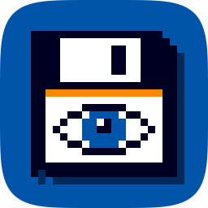
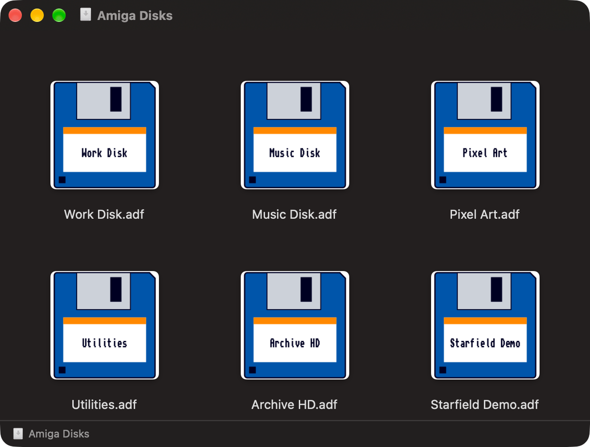
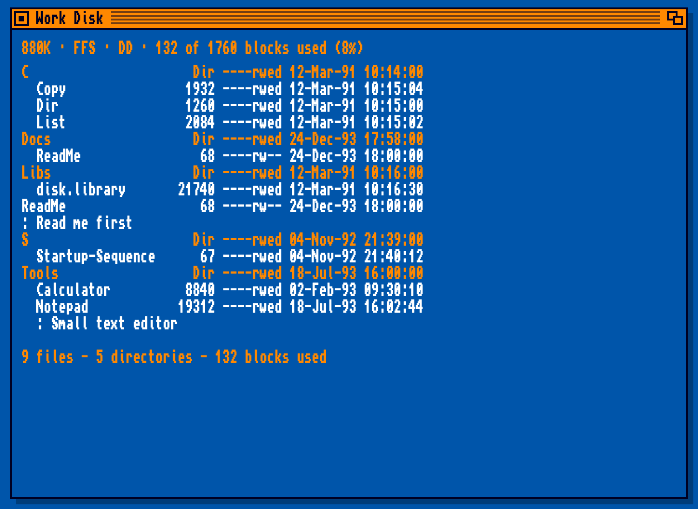
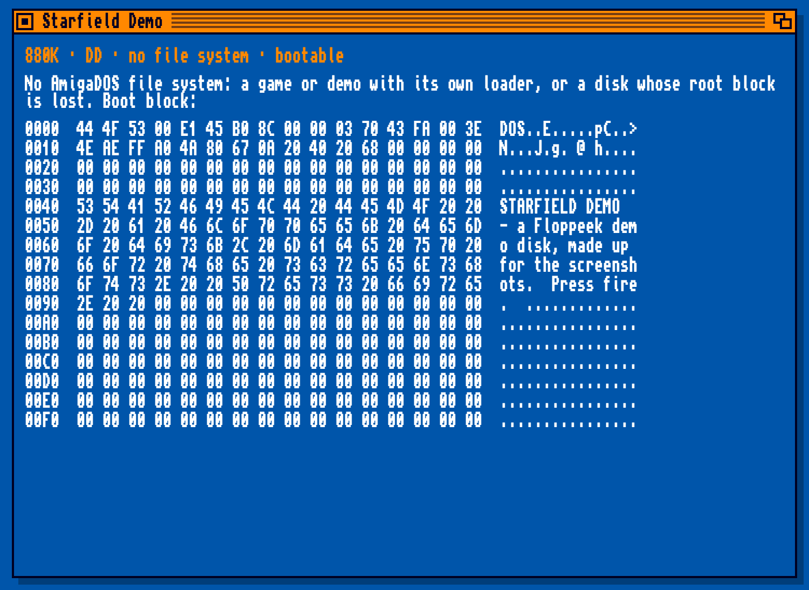

<div align="center">
  

  <h1>Floppeek</h1>

  <p><strong>Quick Look for Amiga disk images on macOS.</strong><br>
  Press Space on an <code>.adf</code> and the disk opens as a Workbench window.</p>

[](https://github.com/gfazioli/floppeek/releases/latest)
[](https://gfazioli.github.io/floppeek/)


**[Visit the website](https://gfazioli.github.io/floppeek/)**: the download, the release notes and how it works, on one page.

</div>

<div align="center">
  <p><br>
  <sub>Made with <a href="https://github.com/gfazioli/glancecard">glancecard</a> · refreshed daily</sub></p>
</div>

<p align="center">
  
</p>

<p align="center">
  
</p>

Select an `.adf` in the Finder and press Space: the disk opens as a Workbench window,
every drawer listed with sizes, protection bits, dates and comments, the way AmigaDOS
`List` prints them, with how full the disk is. In the Finder each disk becomes a 3.5"
floppy with its volume name on the label.

## Install

**Download** the DMG from the [latest release](https://github.com/gfazioli/floppeek/releases/latest),
open it and drag Floppeek onto Applications. It is signed and notarized by Apple.

**Or with Homebrew:**

```sh
brew install --cask gfazioli/tap/floppeek
```

Floppeek needs macOS 15 Sequoia or later, on Apple silicon or Intel.

## Use

1. **Open Floppeek once** from Applications. That registers its two extensions with
   macOS; the window says what to do, and you can close it. Nothing keeps running.
2. **Select an `.adf` in the Finder and press Space** for the preview.
3. **Look at a folder of disks in icon view**: each one is a floppy with its name.

## What it shows

| The disk | The preview |
| --- | --- |
| AmigaDOS, OFS or FFS, double or high density (dumps up to 84 cylinders) | Every drawer and file, sizes, protection bits (`hsparwed`), dates, comments, links, the blocks used |
| No file system: most games and demos, which boot their own loader | The boot block, in hex, and whether it boots |
| Long file names (DOS\6 and DOS\7, OS 3.2) | Recognised, not read yet |

<p align="center">
  
</p>

A damaged disk shows what can still be read, with the problems listed under it:
Floppeek never trusts a pointer on the disk, so loops, blocks outside the disk and bad
checksums are reported, not crashed on.

## If nothing happens

- **Open System Settings › General › Login Items & Extensions › Quick Look** and make
  sure Floppeek is on. The app's **Open Extension Settings** button opens Login Items &
  Extensions. If another app's extension also previews `.adf`, turn off the one you do
  not want there.
- **Reset Quick Look** and relaunch the Finder (Option-right-click its Dock icon,
  Relaunch):

  ```sh
  qlmanage -r && qlmanage -r cache
  ```

## Privacy

The extensions run in Apple's sandbox. They read only the file being previewed, never
the network, and Floppeek collects nothing.

## Coming next

One slice at a time: IFF/ILBM pictures (loose and inside disks), tracker modules
(`.mod`, `.xm`, `.s3m`, `.it`) with their patterns and sound, then Commodore 64 files.
[Releases](https://github.com/gfazioli/floppeek/releases) say what each version adds.

## Build from source

Swift 6 and Xcode (its `actool` compiles the icon); there is no Xcode project.

```sh
swift test                      # the reader against amitools' own listings
scripts/bundle.sh --register    # build/Floppeek.app, signed with your Developer ID
scripts/release.sh --dry-run    # the notarized DMG, publishing nothing
```

[AGENTS.md](AGENTS.md) has the layout, the rules and the traps.

## Sponsor

<div align="center">

[<kbd> <br/> ❤️ If Floppeek brought an old disk back to life for you, please consider becoming a sponsor <br/> </kbd>](https://github.com/sponsors/gfazioli?o=esc)

</div>

Sponsorships pay for the time that keeps Floppeek maintained and growing: the next
formats, fixes, and the testing against real-world disks. Even a small monthly
contribution makes a difference. 💚 [Become a sponsor](https://github.com/sponsors/gfazioli?o=esc)

## Credits and licence

Floppeek is MIT-licensed. The Topaz a1200 font is by dMG of Trueschool and Divine
Stylers ([rewtnull/amigafonts](https://github.com/rewtnull/amigafonts)), GPL with the
font exception. Test disks are made with [amitools](https://github.com/cnvogelg/amitools).

Amiga is a trademark of its owner. Floppeek is not affiliated with or endorsed by it.
